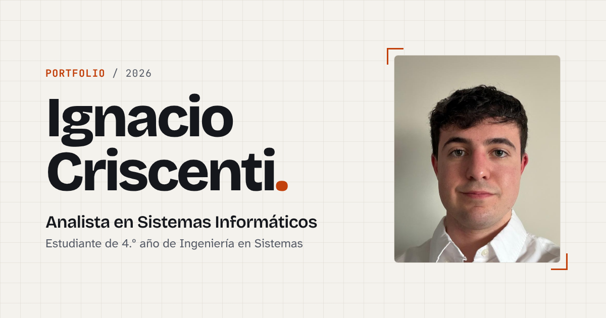

# Portfolio — Ignacio Criscenti

Portfolio personal de **Ignacio Criscenti**, Analista en Sistemas Informáticos y estudiante de 4.º año de Ingeniería en Sistemas (UAI).

🔗 **Sitio publicado:** https://ignacio-criscenti.vercel.app



## Stack

| Herramienta | Uso |
| --- | --- |
| [Astro 7](https://astro.build) | Generador de sitio estático. Componentes `.astro`, cero JavaScript por defecto. |
| [Tailwind CSS 4](https://tailwindcss.com) | Estilos utilitarios, integrado con el plugin `@tailwindcss/vite`. |
| TypeScript | Datos del sitio y scripts del cliente tipados. |
| [Fontsource](https://fontsource.org) | Tipografías de Google Fonts auto-hospedadas: Bricolage Grotesque, Atkinson Hyperlegible Next y JetBrains Mono. |
| `astro:assets` | Optimización automática de la foto (WebP en varios tamaños). |

No usa librerías de UI ni frameworks de JavaScript: el menú, el cambio de tema, las animaciones y la validación del formulario son scripts chicos en TypeScript.

## Cómo correrlo localmente

Requisitos: **Node.js 22.12 o superior** y npm.

```bash
git clone https://github.com/IgnaCriscenti/Portfolio.git
cd Portfolio
npm install
npm run dev        # servidor de desarrollo en http://localhost:4321
```

Otros comandos:

| Comando | Qué hace |
| --- | --- |
| `npm run build` | Genera el sitio estático en `dist/` |
| `npm run preview` | Sirve la versión de `dist/` para probarla antes de publicar |

## Estructura

```
├── cv/cv.html                 # Fuente del CV en PDF
├── public/
│   ├── cv-ignacio-criscenti.pdf
│   ├── og-image.png           # Imagen de vista previa al compartir el link
│   └── favicon.svg
└── src/
    ├── assets/                # Foto (Astro la optimiza en el build)
    ├── components/            # Header, Hero, About, Projects, Education, Contact, Footer…
    ├── data/profile.ts        # TODO el contenido: textos, habilidades, proyectos, links
    ├── layouts/Layout.astro   # <head>, meta tags y tema claro/oscuro
    ├── pages/index.astro      # Página única que arma las secciones
    └── styles/global.css      # Tokens de diseño (colores, tipografías) y estilos base
```

Para cambiar textos, proyectos o links alcanza con editar `src/data/profile.ts`.

## Secciones

1. **Hero** — nombre, rol, frase de presentación, botones "Ver proyectos" / "Contactarme" / "Descargar CV" y foto.
2. **Sobre mí** — bio, ficha técnica y habilidades agrupadas (Frontend, Backend, Bases de datos, Herramientas).
3. **Proyectos** — ElectroTech, Futbolle y Jugada Maestra, con descripción, tecnologías y links.
4. **Formación** — línea de tiempo de estudios e idiomas.
5. **Contacto** — email, GitHub, LinkedIn, CV y formulario validado.

## Detalles técnicos

- **Responsive** probado en 360 px, 768 px y 1280 px, sin scroll horizontal.
- **HTML semántico**: `header`, `nav`, `main`, `section`, `article`, `footer` y un único `h1`.
- **Accesibilidad**: link "Saltar al contenido", foco visible, `alt` en la imagen, contraste AA verificado en ambos temas, menú mobile con `aria-expanded` y cierre con Escape, errores del formulario anunciados con `aria-invalid` y `aria-live`.
- **Modo claro / oscuro**: respeta la preferencia del sistema y recuerda la elección del usuario. Un script en el `<head>` aplica el tema antes de pintar para evitar el parpadeo.
- **Animaciones sutiles** al hacer scroll con `IntersectionObserver`, desactivadas si el usuario tiene `prefers-reduced-motion`.
- **Formulario de contacto**: valida nombre (mín. 2 caracteres), email (formato válido) y mensaje (10 a 1000 caracteres). Como el sitio es estático, al enviarlo se abre la app de correo con el mensaje precargado.
- **CV descargable** generado desde `cv/cv.html` (Chrome → Imprimir → Guardar como PDF, A4, márgenes "Ninguno", con gráficos de fondo).

### Lighthouse

| | Performance | Accessibility | Best Practices | SEO |
| --- | --- | --- | --- | --- |
| Mobile | 100 | 100 | 100 | 100 |
| Desktop | 100 | 100 | 100 | 100 |

## Deploy en Vercel

1. Entrar a [vercel.com](https://vercel.com) con la cuenta de GitHub.
2. **Add New → Project** e importar el repositorio `Portfolio`.
3. Vercel detecta Astro solo (build: `npm run build`, salida: `dist`). Tocar **Deploy**.
4. Copiar la URL final y ponerla en `site` dentro de `astro.config.mjs` (se usa para las meta tags) y arriba en este README.

Cada `git push` a `main` vuelve a publicar el sitio automáticamente.

## Diseño

La dirección de arte (concepto, paleta, tipografías y layout) está documentada en [`DISENO.md`](DISENO.md).
